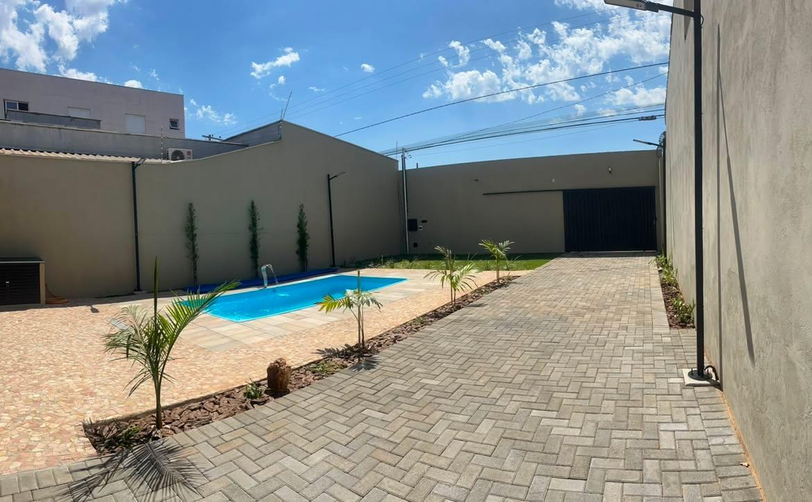
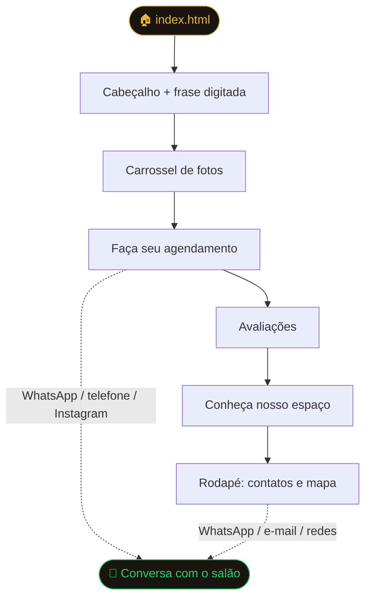
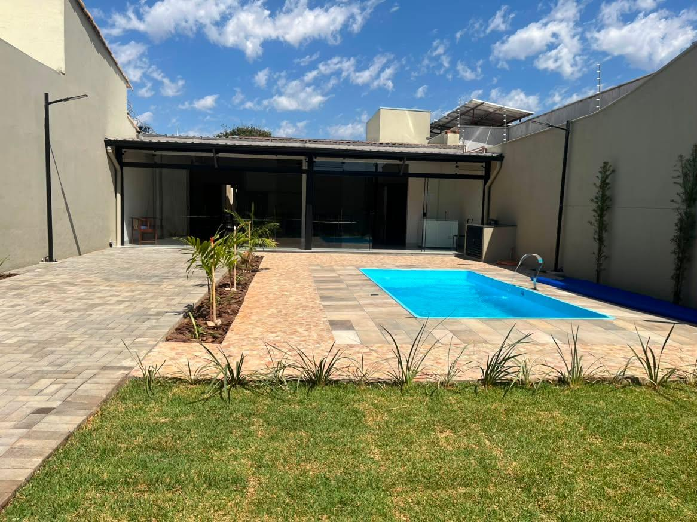
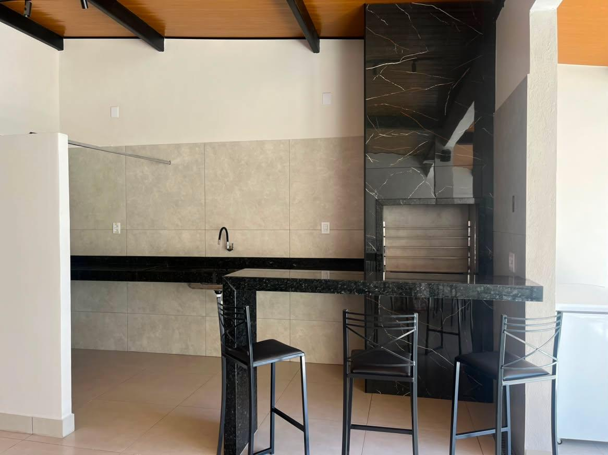
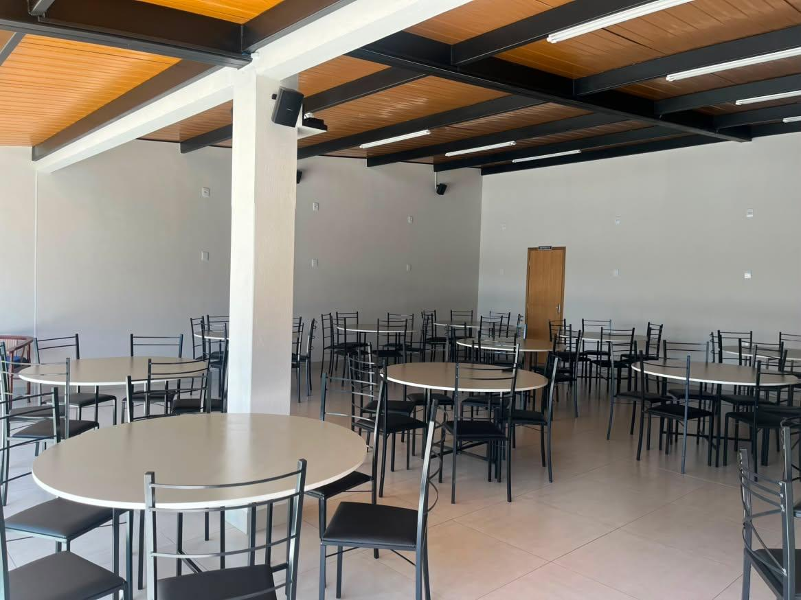
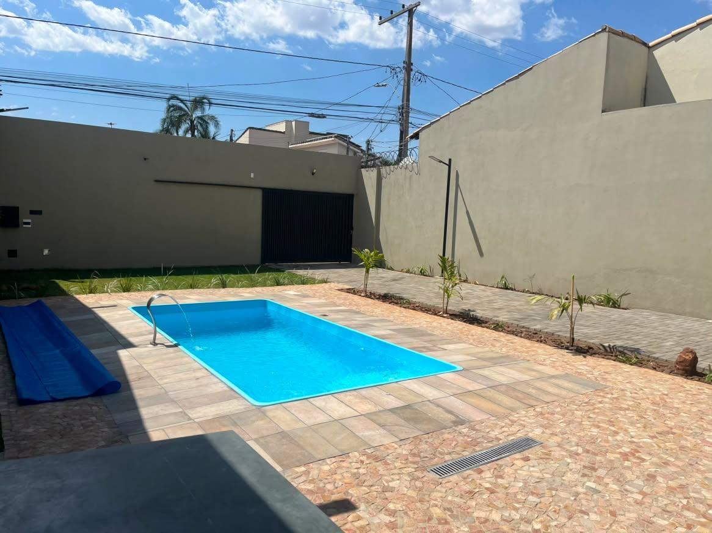

<div align="center">



<br />


### 🥂 O site oficial do **D' Avillas Fest**
*Salão de festas em Uberlândia/MG: um espaço pensado para você celebrar seus momentos especiais.*

</div>

---

## ✨ Sobre este documento

Este README **não é um manual de instalação**. O site é a vitrine de um negócio, não uma ferramenta para ser reaproveitada por outras pessoas. Aqui eu apenas conto **o que o site é, o que ele mostra e como ele foi pensado**.

---

## 🧭 O que é o D' Avillas Fest

O **D' Avillas Fest** é um salão de festas em **Uberlândia/MG**, com área coberta para mesas e convidados, churrasqueira, piscina e jardim. O próprio site resume a ideia em uma frase, que aparece digitada na tela logo de cara:

> **"Um espaço pensado para você."**

O site existe para três coisas: **mostrar o espaço**, **passar confiança com as avaliações de quem já fez festa por lá** e **levar o visitante a agendar uma data**, de preferência pelo WhatsApp.

---

## 🗺️ Estrutura do site

O site tem **uma única página**, e todo o caminho do visitante acontece em uma rolagem só, de cima para baixo.



### 🏠 Página inicial (`index.html`)

Uma página longa sobre **fundo escuro**, com detalhes em **dourado**, para dar um ar elegante e acolhedor.

| Seção | O que o visitante encontra |
| :-- | :-- |
| **Cabeçalho** | Nome **D' AVILLAS FEST** e o botão **"Agendar Agora"**. Ele fica fixo no topo e encolhe quando a página começa a rolar. |
| **Frase digitada** | Um efeito de máquina de escrever que alterna entre *"D' AVILLAS FEST"*, *"UM ESPAÇO PENSADO PARA VOCÊ"* e *"AGENDE AGORA"*. |
| **Carrossel** | Faixa de fotos que corre sem parar, com as bordas suavizadas. Passar o mouse pausa o movimento, e clicar em uma foto abre a imagem ampliada. |
| **Faça seu agendamento** | Três botões: **WhatsApp**, **Ligue agora** e **Instagram**. |
| **Avaliações** | Cartões com o nome, as estrelas e o comentário de quem já fez festa no salão, com paginação e um botão para ver mais avaliações no Google. |
| **Conheça nosso espaço** | Galeria com **8 fotos** em grade. Cada uma pode ser ampliada com um clique. |
| **Rodapé** | WhatsApp, Instagram, Facebook, TikTok, e-mail, endereço e um **mapa do Google** mostrando onde o salão fica. |

<table>
  <tr>
    <td align="center" width="25%"><br /><sub><b>Piscina e jardim</b></sub></td>
    <td align="center" width="25%"><br /><sub><b>Churrasqueira</b></sub></td>
    <td align="center" width="25%"><br /><sub><b>Salão coberto</b></sub></td>
    <td align="center" width="25%"><br /><sub><b>Vista do portão</b></sub></td>
  </tr>
</table>

---

## 🎨 Identidade visual

O visual é **escuro, sofisticado e dourado**, com títulos em itálico de letra serifada, que passam a sensação de um convite de festa.

| Elemento | Escolha |
| :-- | :-- |
| **Fundo** |  `#191612` (preto amarronzado) |
| **Cor principal** |  `#e6b43d` (dourado) |
| **Dourado de apoio** |  `#c89b3c` |
| **Texto de apoio** |  `#b7b7b7` (cinza claro) |
| **Botão do WhatsApp** |  `#25d366` (verde do app) |
| **Títulos** | Serifada em itálico (*Playfair Display*, com *Times New Roman* de reserva) |
| **Textos** | Sem serifa (*Montserrat*, com *Arial* de reserva) |

---

## 🎬 Movimento e interação

As animações são **discretas**, feitas para dar vida ao site sem atrapalhar a leitura:

- ⭕ **Tela de entrada:** um emblema dourado com as letras *D'A* pulsa por um instante enquanto o site carrega
- ⌨️ **Frase digitada** no topo, com cursor piscando
- 🎠 **Carrossel infinito** de fotos, que pausa ao passar o mouse e quando uma foto está ampliada
- 🖼️ **Ampliar fotos:** clicar em qualquer foto do carrossel ou da galeria abre a imagem em tela cheia, com fundo escurecido
- 👀 **Revelação ao rolar:** os blocos aparecem aos poucos conforme a pessoa desce a página
- 🧾 **Cabeçalho que encolhe** ao rolar, sem "tremer" na hora da troca
- 💬 **Botão flutuante do WhatsApp** que acompanha a pessoa pela página inteira
- ⬆️ **Botão "voltar ao topo"** que aparece depois de um bom trecho de rolagem
- 🃏 **Cartões de avaliação** que entram um após o outro

---

## 📱 Pensado para qualquer tela

- O cabeçalho, os botões e a galeria se reorganizam em **três faixas de tela** (computador, tablet e celular)
- A grade de fotos passa de 4 colunas para menos colunas até chegar a **uma só no celular**
- As imagens carregam **sob demanda** (*lazy loading*), o que deixa a página mais leve
- A cor da barra do navegador no celular combina com o fundo do site
- O botão de ligar usa o `tel:`, então **um toque já chama o salão**

### ♿ Acessibilidade

- Rótulos descritivos nos botões e nos links principais
- A lista de avaliações avisa leitores de tela quando o conteúdo muda de página
- Destaque dourado visível ao navegar pelo teclado
- A foto ampliada fecha com a tecla `Esc`, com o botão **×** ou com um clique fora da imagem
- Quem prefere **menos movimento** no sistema recebe o site sem o carrossel e sem as animações

---

## 📞 Como o cliente chega até você

Todo o site é desenhado em torno de um objetivo: **transformar visita em agendamento**.

```text
 Visitante ──▶ vê as fotos e as avaliações ──▶ clica em "Agendar Agora"
                                                      │
                  ┌───────────────────┬───────────────┴───────────────┐
                  ▼                   ▼                               ▼
           💬 WhatsApp          📞 Ligação                      📸 Instagram
      (mensagem já montada)    (um toque no celular)         (conhece o perfil)
```

A mensagem do WhatsApp já abre escrita: *"Olá, tenho interesse em fazer um agendamento, pode me ajudar?"*

| Canal | Contato |
| :-- | :-- |
| 💬 **WhatsApp** | (34) 99695-5290 |
| ✉️ **E-mail** | avillasfest@gmail.com |
| 📸 **Instagram** | [@avillasfest](https://www.instagram.com/avillasfest/) |
| 📘 **Facebook** | [D' Avillas Fest](https://www.facebook.com/share/1NN1Fq6Kmx/) |
| 🎵 **TikTok** | [@avillasfest](https://www.tiktok.com/@avillasfest) |
| 📍 **Endereço** | Rua Fábio Masini, 103 · Uberlândia/MG |

---

## 🧱 Como o site é feito

É um site **estático e enxuto**, sem framework e sem etapa de build. Tudo roda direto no navegador.

```text
site/
├── index.html        → a página inteira
├── style.css         → todo o visual e as animações
├── script.js         → carrossel, ampliação de fotos, avaliações e efeitos
├── assets/           → fotos do salão (.jpg e .webp)
└── LICENSE           → licença MIT
```

- 📦 O site inteiro pesa **cerca de 1,4 MB**, quase tudo em fotos (os três arquivos de código somam só uns 50 KB)
- 🌐 As dependências externas são os **ícones do WhatsApp e do Instagram** (hospedados no Flaticon) e o **mapa do Google**
- 🗂️ A lista de avaliações é montada por script a partir de uma lista simples, então **adicionar uma avaliação nova é só incluir um bloco**
- 🔍 A página tem título, descrição e prévia para compartilhamento (*Open Graph*), para aparecer bem em buscadores e em links enviados por mensagem

---

<div align="center">

**D' Avillas Fest** · *Festas & Eventos em Uberlândia/MG*

Site feito por **Matheus D'Ávila** · **Nex7 Step** · © 2026

<sub>Um espaço pensado para você. 🥂</sub>

</div>
